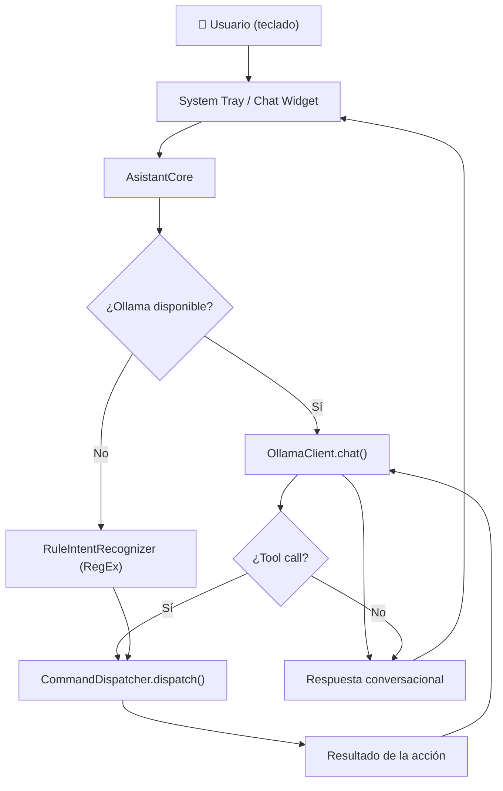

# Interfaz Jarvis — System Tray + IA Local con Tool Calling

Implementar la capa de interfaz del asistente: un system tray con popup de chat minimalista, una IA local (Ollama) que interprete las peticiones del usuario y las envíe a la capa de negocios existente, con fallback al recognizer de reglas.

## User Review Required

> [!IMPORTANT]
> **Framework del System Tray**: Propongo usar **PyQt6** para la GUI (system tray + popup de chat). Es el framework de escritorio más maduro para Python y tiene soporte nativo de system tray en Linux/Windows. Alternativa: `pystray` + `tkinter` (más liviano pero menos pulido). ¿Te parece bien PyQt6?

> [!IMPORTANT]
> **Tool Calling con Ollama**: Para que la IA decida cuándo ejecutar acciones del sistema, voy a implementar un sistema de **tool calling** (function calling). Ollama con llama3.2 soporta esto nativamente. La IA recibirá la lista de herramientas disponibles (`open_app`, `open_url`, `check_process`, `execute_command`) y decidirá cuál usar, o simplemente conversará si no necesita ninguna.

> [!WARNING]
> **Bug en `assistant.py`**: El método `procces_input` tiene un `return` antes del `dispatch` (línea 40-45), lo que hace que el dispatch nunca se ejecute. Además usa `Dict()` como constructor (debería ser `dict()`). Voy a corregir esto como parte de la implementación.

## Open Questions

> [!IMPORTANT]
> **Hotkey global**: ¿Querés que el popup se abra/cierre con un atajo de teclado global (ej. `Ctrl+Space` o `Alt+J`)? Esto requiere una dependencia extra (`pynput` o similar).

## Proposed Changes

### Componente 1: AI Brain — Cliente LLM + Tool Calling

Implementar la conexión con Ollama y el sistema de tool calling que permite a la IA decidir qué acciones ejecutar.

---

#### [MODIFY] [prompts.py](file:///home/matias/Escritorio/Jarvis/src/ai_brain/prompts.py)

System prompt para Jarvis que define su personalidad, capacidades y el formato de las herramientas. El prompt instruirá al modelo para:
- Responder conversacionalmente cuando no se requiere acción
- Usar tool calling cuando detecte una intención de acción del sistema
- Responder siempre en español

#### [MODIFY] [tools_registry.py](file:///home/matias/Escritorio/Jarvis/src/ai_brain/tools_registry.py)

Registro de herramientas que traduce las capacidades de la capa de negocios a definiciones de tools compatibles con la API de Ollama. Cada herramienta mapea a una acción del `CommandDispatcher`:

| Tool Name | Acción del Dispatcher | Parámetros |
|-----------|----------------------|------------|
| `open_app` | `open_app` | `app_name: str` |
| `open_url` | `open_url` | `url: str` |
| `check_process` | `check_process` | `process_name: str` |
| `execute_command` | `execute_command` | `command: str` |

#### [MODIFY] [llm_client.py](file:///home/matias/Escritorio/Jarvis/src/ai_brain/llm_client.py)

Cliente que encapsula la comunicación con Ollama:
- `OllamaClient` con método `chat(user_message) → LLMResponse`
- Manejo de tool calls: si el modelo responde con tool_calls, ejecutarlas vía `CommandDispatcher` y alimentar el resultado de vuelta al modelo
- Historial de conversación en memoria
- Timeout y manejo de errores (Ollama caído, modelo no disponible)
- Config desde `confing.json`

#### [MODIFY] [__init__.py](file:///home/matias/Escritorio/Jarvis/src/ai_brain/__init__.py)

Exports del módulo.

---

### Componente 2: NLU — LLM Intent Recognizer con Fallback

Nuevo recognizer que usa la IA como motor de clasificación, con fallback automático a reglas.

---

#### [NEW] [llm_recognizer.py](file:///home/matias/Escritorio/Jarvis/src/NLU/intent_recognizer/llm_recognizer.py)

Implementación de `BaseIntentRecognizer` que usa `OllamaClient` para interpretar intenciones. Si Ollama no está disponible, delega al `RuleIntentRecognizer` como fallback.

#### [MODIFY] [factory.py](file:///home/matias/Escritorio/Jarvis/src/NLU/intent_recognizer/factory.py)

Agregar opción `"llm"` al factory que instancie el `LLMIntentRecognizer`.

---

### Componente 3: Core — Corrección de bugs + nuevo flujo con IA

---

#### [MODIFY] [assistant.py](file:///home/matias/Escritorio/Jarvis/src/core/assistant.py)

Correcciones:
- **Bug fix**: El `return` en el bloque `unknown` impide que el dispatch se ejecute → mover el `dispatch` al `else`
- **Bug fix**: `Dict()` → `dict()` (Dict no es un constructor válido)
- Agregar soporte para recibir un `OllamaClient` opcional. Si se provee, el flujo cambia:
  - Texto → LLM → Tool Calling → Dispatcher → Respuesta formateada por LLM
  - Si LLM no disponible → fallback al flujo actual (RegEx → Dispatcher)

---

### Componente 4: Interfaz — System Tray + Chat Popup

GUI minimalista con PyQt6: ícono en la bandeja del sistema + ventana flotante con chat.

---

#### [MODIFY] [system_tray.py](file:///home/matias/Escritorio/Jarvis/src/interface/system_tray.py)

System tray con ícono y menú contextual:
- Ícono de Jarvis en la bandeja del sistema
- Click izquierdo → abrir/cerrar popup de chat
- Menú contextual (click derecho): "Abrir Chat", "Configuración", "Salir"
- Notificaciones del sistema (para mostrar resultados de acciones)

#### [MODIFY] [cli.py](file:///home/matias/Escritorio/Jarvis/src/interface/cli.py)

CLI como interfaz alternativa (útil para debugging):
- Loop de input de texto
- Muestra las respuestas de la IA y las acciones ejecutadas
- Comando `exit` / `quit` para salir

#### [NEW] [chat_widget.py](file:///home/matias/Escritorio/Jarvis/src/interface/chat_widget.py)

Widget de chat flotante (popup) con PyQt6:
- Ventana sin barra de título, con bordes redondeados, estilo glassmorphism oscuro
- Campo de entrada de texto en la parte inferior
- Área de mensajes scrollable (burbujas de chat usuario/asistente)
- Indicador de "escribiendo..." mientras la IA procesa
- Animación de aparición/desaparición suave
- Se posiciona junto al ícono del system tray
- `Enter` para enviar, `Esc` para cerrar

#### [NEW] [styles.py](file:///home/matias/Escritorio/Jarvis/src/interface/styles.py)

Stylesheet QSS centralizado para la UI:
- Paleta oscura premium (grises profundos + acentos cyan/violeta)
- Tipografía Inter (Google Fonts)
- Bordes redondeados y sombras suaves
- Estilo de burbujas de chat diferenciado (usuario vs asistente)

#### [NEW] [assets/jarvis_icon.png](file:///home/matias/Escritorio/Jarvis/src/interface/assets/jarvis_icon.png)

Ícono para el system tray (generado).

---

### Componente 5: Entry Point

---

#### [MODIFY] [main.py](file:///home/matias/Escritorio/Jarvis/main.py)

Entry point del proyecto que:
1. Carga la configuración desde `confing.json`
2. Inicializa las factories (OS adapter, app finder, intent recognizer)
3. Crea el `CommandDispatcher` y el `AsistantCore`
4. Inicializa el `OllamaClient` (si está disponible)
5. Lanza la app PyQt6 con el system tray
6. Alternativa `--cli` para modo terminal

---

### Componente 6: Dependencias

---

#### [MODIFY] [requirements.txt](file:///home/matias/Escritorio/Jarvis/requirements.txt)

Agregar:
```
PyQt6>=6.5.0
```

---

## Arquitectura del Flujo



## Verification Plan

### Automated Tests
```bash
# Tests existentes deben seguir pasando
.venv/bin/python -m pytest tests/ -v

# Test manual del LLM client
.venv/bin/python -c "from src.ai_brain.llm_client import OllamaClient; c = OllamaClient(); print(c.chat('hola'))"
```

### Manual Verification
1. Ejecutar `python main.py` → verificar que aparece el ícono en el system tray
2. Click en el ícono → verificar que se abre el popup de chat
3. Escribir "abre spotify" → verificar que la IA ejecuta la acción
4. Escribir "¿qué hora es?" → verificar que la IA responde conversacionalmente
5. Detener Ollama → verificar que el fallback a reglas funciona
6. Ejecutar `python main.py --cli` → verificar modo terminal
